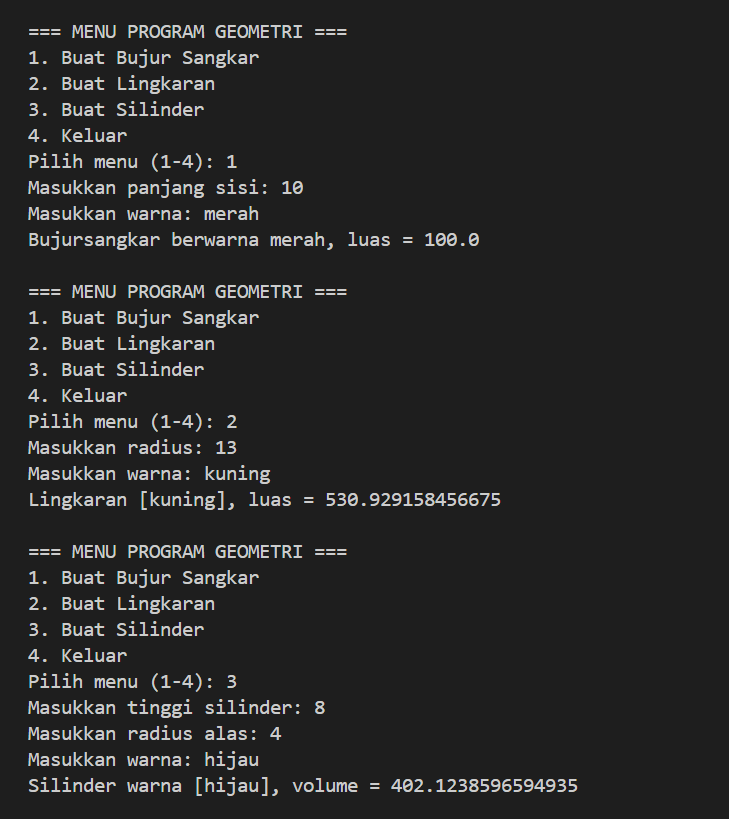

# Tugas PBO - Inheritance & Polymorphism

## Penjelasan pada Kode
1. **Encapsulation (Enkapsulasi):** 
   - Variabel atribut seperti `sisi` pada kelas `BujurSangkar`, `radius` pada kelas `Lingkaran`, dan `tinggi` pada kelas `Silinder` menggunakan modifier `private` atau `protected`.
   - Diakses dan dimodifikasi melalui method getter (`get...()`) dan setter (`set...()`).
2. **Inheritance (Pewarisan):** 
   - Kelas `BujurSangkar` dan `Lingkaran` mewarisi kelas `Bentuk`.
   - Kelas `Silinder` mewarisi kelas `Lingkaran` (multilevel inheritance).
3. **Polymorphism (Polimorfisme):** 
   - Method `printInfo()` di-override pada setiap sub-kelas untuk menampilkan informasi spesifik sesuai bentuk geometrinya masing-masing.

## Screenshot Eksekusi Program
